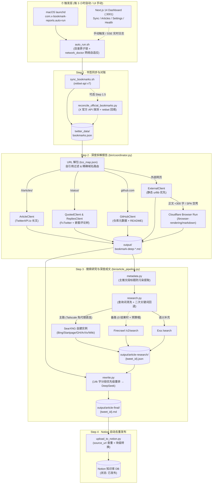

<div align="center">

# 🔖 x-bookmark-reports

**Twitter / X 书签 → 深度拆解报告 → 多源搜索研究 → AI 深度成文 → Notion 知识库全自动流水线**

[](#)
[](#)
[](#)
[](#)
[](#)
[](#)

[核心特性](#-核心特性) •
[系统架构](#-系统架构与数据流) •
[无头浏览器与搜索栈](#-cloudflare-无头浏览器与研究搜索栈) •
[快速开始](#-快速开始) •
[环境配置](#️-环境配置) •
[命令行手册](#-命令行手册) •
[定时与运维](#-定时任务与运维保障)

</div>

---

## ✨ 核心特性

`x-bookmark-reports` 是一套专为高密度技术信息摄入打造的本地自动化知识工程系统。它每 3 小时自动从 X (Twitter) 同步最新书签，补全长文、引用链、评论区、GitHub README 与动态网页外链，结合自建聚合搜索与大模型改写，产出一篇篇结构严谨的中文深度技术文章并自动归档至 Notion。

| 模块 | 核心能力亮点 |
| :--- | :--- |
| **1. 书签增量同步与官方对账** | 基于 `rettiwt-api` 增量拉取书签并去重合并；内置可选的 **X 官方 API 差集对账器**（`reconcile_official_bookmarks.py`），自动探测 GraphQL 延迟漏抓并按 ID 精准回填。 |
| **2. 智能短链解包与多源深报** | 先解包 `t.co` 短链（`curl` UA 301 直取 + HTML `meta-refresh` 兜底 + 永久映射缓存）、过滤自身配图伪引用，再按真实域名精准路由至 **X Article**、**FxTwitter**、**GitHub README** 与 **外部网页客户端**。 |
| **3. Cloudflare 无头浏览器兜底** | 外部链接采用 **「静态 `urllib` 极速抓取 → Cloudflare Browser Run (`/browser-rendering/markdown`) 无头浏览器渲染」** 双层架构，自动攻克 React/Vue/Next.js 纯前端 SPA 空壳页，将网页转成结构化 Markdown。 |
| **4. 自建 SearXNG 研究搜索栈** | 免代理直连 Tailscale 内网自托管 **SearXNG**（聚合 Bing / Startpage / Mojeek / Google / GitHub / ArXiv / Wikipedia），支持口语化标题清洗与 0 结果专有名词二次检索，后接 **Firecrawl**（带熔断预算帽）与 **Exa** 语义检索。 |
| **5. 优先级感知成文管线** | 送入 DeepSeek 成文前，按 **「主推文 → 引用推文 → 外部链接详情 → 回复线程」** 智能重排 14,000 字上下文配额，确保核心外链与代码库干货绝不被长评论挤占；写盘前强制校验最短正文门槛。 |
| **6. Next.js 14 可视化控制台** | 提供现代化 Web 控制台（端口 `3001`）：全生命周期统计卡片、4 阶段 Pipeline 状态机、SSE 实时终端日志流、launchd 调度预设一键切换、以及带服务端节流防刷的 API 健康检查横幅。 |

---

## 🏗 系统架构与数据流



---

## 🌐 Cloudflare 无头浏览器与研究搜索栈

针对技术推文中常见的 **动态渲染网页（SPA）** 与 **多源背景调研** 需求，系统构建了两套互补的零维护成本底座：

### 1. 外部网页双层抓取架构（`ExternalClient` + `CF Browser Run`）

在 Step 2 生成深度报告时，推文附带的外部链接按以下策略处理：

1. **短链前置解包**：使用非浏览器 UA（`curl/8.0`）配合 `_NoRedirect` 直接提取 `t.co` 的 `HTTP 301 Location` 头（辅以 HTML `meta-refresh` / `<title>` 兜底），并将映射永久缓存在 `cache/tco_map.json`。
2. **第一层（本地 `urllib` 静态快抓）**：对 GitHub、传统博客、Substack 等服务端渲染页面毫秒级提取正文并缓存 24 小时。
3. **第二层（Cloudflare Browser Run 动态渲染兜底）**：当主推文或引用推文的外链满足以下任一条件时，自动移交 `lib/cf_browser_client.py` 调用 Cloudflare 边缘无头浏览器渲染并提取干净 Markdown：
   - 静态抓取返回的 HTML 正文 **不足 300 字符**（典型 React / Vue / Next.js 空壳页，如 ModelScope、PortMenu 等）；
   - 页面内容命中 `enable JavaScript` / `Just a moment...` 等动态挑战特征；
   - 静态请求遭遇 `HTTP 403 / 429 / 5xx` 或 TLS 握手异常。
4. **三道安全护栏（零超额风险）**：
   - **UTC 每日时长账本（`cache/cf_browser_usage.json`）**：自动读取每次响应头 `X-Browser-Ms-Used` 累加真实浏览器毫秒数，达到每日安全预算（默认 `480,000 ms` = **8 分钟/天**，在 Cloudflare 免费层 10 分钟/天内留足余量）自动熔断至次日 UTC 零点；
   - **自适应退避限速**：默认最小间隔 `1.5s`，若遇 `HTTP 429` 自动按 `Retry-After` 退避重试并将本进程间隔提升至 `10.5s`；
   - **单进程预算帽与域名负缓存**：单次运行最多调用 `20` 次；连续失败 3 次的域名自动进入 7 天负缓存；同时自动将渲染后的 Markdown 标题下沉 3 级（`#` → `####`），避免破坏深度报告自身的章节层级。

### 2. 三级研究检索栈（`SearXNG` 主 → `Firecrawl` 备 → `Exa` 补充）

| 优先级 | 服务 | 定位与防线机制 |
| :---: | :--- | :--- |
| **主路** | **SearXNG（自托管）** | 跑在 Tailscale 节点（`127.0.0.1:8888` + `tailscale serve` 内网暴露，单容器常驻仅 ~120MB 内存）。Python 侧通过独立 `requests.Session(trust_env=False)` 免代理直连；自动清洗推文 Emoji/口水前缀，若长句 0 结果自动提取仓库名或英文技术词二次检索。 |
| **备路** | **Firecrawl `/v2/search`** | 仅当 SearXNG 两次检索均返回 0 结果时触发。内置进程级 `402/429` 熔断器与单次运行调用上限（`FIRECRAWL_MAX_CALLS_PER_RUN=50`），防止异常情况下烧穿月度额度。 |
| **补充** | **Exa `/search`** | 向量语义搜索补充，每次返回 Top 5 高相关技术文档摘要（各 1,000 字符），与 SearXNG 结果合并去重后共同喂给 DeepSeek。 |
| **可选** | **xAI (Grok)** | 支持 Responses API (`web_search` + `x_search`)；未配置或遇 `403` 额度耗尽时进程级单次熔断，零阻塞跳过。 |

---

## 🚀 快速开始

### 1. 启动 Web Dashboard (Next.js)

```bash
cd ui/
npm install
npm run build   # 生产构建
npm start       # 启动生产服务（默认端口 3001）

# 或启动开发模式：
npm run dev
```

打开浏览器访问 **`http://127.0.0.1:3001`**（建议用 `127.0.0.1` 绕过本地系统代理），包含 5 个核心功能区：

| 页面路由 | 功能说明 |
| :--- | :--- |
| **Dashboard (`/`)** | 6 张全链路统计卡片（总书签 / 深度草稿 / 本地成文 / Notion 总页数 / 本周新增）+ 4 节点 Pipeline 状态图 + 顶部实时健康告警条 |
| **Bookmarks (`/bookmarks`)** | 书签全集浏览、按生命周期（`pending` / `drafted` / `written` / `uploaded`）与分类筛选、查看原始推文与深度报告 |
| **Sync (`/sync`)** | 流水线控制中心：一键触发同步书签、运行成文管线、上传 Notion，内嵌 SSE 实时终端输出流 |
| **Articles (`/articles`)** | 成品文章管理：阅读/编辑 Markdown、切换单篇重跑模型、查看关联研究来源与 Notion 同步状态 |
| **Settings (`/settings`)** | 五合一配置面板：**General** / **LLM & Web Search（含 Cloudflare Browser Run 卡片与今日时长监控）** / **Schedule（launchd 预设）** / **Logs** / **Data** |

> 🌏 **中英双语**：右上角「中 / EN」按钮切换界面语言，偏好存在浏览器 localStorage，首次访问按浏览器语言自动选择。文案在 `ui/src/lib/i18n/messages/<命名空间>.ts`，以英文为基准，中文必须逐键对应（缺键时 `tsc` 报错）；组件中用 `const t = useT(); t("settings.tab.general")` 取文案。服务端返回的告警、诊断结果等提供 `code + params`，由前端按当前语言渲染。

> 💡 **macOS 快捷方式**：直接双击仓库根目录下的 `Open Dashboard UI.command` 即可自动检查构建并打开浏览器。

### 2. 运行全自动流水线

```bash
# 正常运行（含代理连通性检查 + 同步 + 深度报告 + 研究成文 + Notion 上传）
bash auto_run.sh

# 跳过代理检查强制执行
bash auto_run.sh --force
```

---

## 📁 目录结构

```text
x-bookmark-reports/
├── auto_run.sh                        # launchd 定时任务总入口（单实例目录锁 + 4 步流水线）
├── Open Dashboard UI.command          # macOS 双击启动 Dashboard 脚本
├── bin/
│   ├── coordinator.py                 # Step 2: 深度报告生成 CLI
│   ├── article_pipeline.py            # Step 3: 成品文章管线 CLI（metadata → research → rewrite）
│   ├── upload_to_notion.py            # Step 4: Notion 上传 CLI（source_url 查重 + 分块写入）
│   ├── reconcile_official_bookmarks.py# Step 1.5: X 官方 API 书签差集对账与回填脚本
│   ├── reconcile_deep_state.py        # 深度报告状态文件与磁盘/归档目录对账工具
│   └── backfill_notion_pubdate.py     # Notion 历史页面「发布时间」时区校准回填工具
├── lib/
│   ├── config.py                      # 环境变量与全局配置中心
│   ├── tz.py                          # 产品统一时区工具（默认 Asia/Singapore）
│   ├── coordinator.py                 # 书签分类、短链解包分流与深度报告编排核心
│   ├── external_client.py             # 外部链接客户端（t.co 解包 + urllib + CF 渲染兜底）
│   ├── cf_browser_client.py           # Cloudflare Browser Run 客户端与每日 UTC 额度账本
│   ├── article_client.py              # TwitterAPI.io 长文 (X Article) 客户端
│   ├── quoted_client.py               # FxTwitter 引用推文客户端
│   ├── replies_client.py              # TwitterAPI.io 评论区抓取与回复树构建
│   ├── github_client.py               # GitHub 仓库元数据与 README 客户端（gh CLI / REST）
│   ├── media_utils.py                 # 推文图片/视频媒体元数据提取
│   ├── report_builder.py              # 深度报告 Markdown 组装器
│   └── article_pipeline/              # Step 3 成品文章管线子模块
│       ├── state.py                   # 管线状态机管理（.article-pipeline-state.json）
│       ├── metadata.py                # 深度报告白名单切段与主推文标题提取
│       ├── research.py                # SearXNG 主 → Firecrawl 备 → Exa 补充研究编排
│       ├── rewrite.py                 # 14k 字分段优先级重排与 DeepSeek 成文器
│       └── prompts/                   # 研究与改写 System Prompts
├── ui/                                # Next.js 14 Dashboard (App Router + Tailwind + SQLite)
│   ├── src/app/                       # 页面与 API Routes (/api/health, /api/settings, /api/articles...)
│   ├── src/components/                # UI 组件（HealthBanner, LLMSettings, PipelineOverview...）
│   ├── src/lib/                       # 文件系统数据层 (fs-data.ts)、配置 (config.ts)、时区与 Notion 统计
│   └── src/types/                     # 前后端共享 TypeScript 契约 (api.ts)
├── docs/                              # 审计报告与变更日志 (CHANGELOG.md)
├── output/                            # [gitignore] 深度草稿、成品文章 (article-final/) 与状态文件
├── cache/                             # [gitignore] API 缓存、tco_map.json 与 cf_browser_usage.json
├── logs/                              # [gitignore] 持久化运行日志 (bookmark-auto.log)
└── .env.example                       # 环境变量配置模板
```

---

## ⚙️ 环境配置

复制 `.env.example` 为 `.env` 并按需填写（也可在 Dashboard 的 **Settings** 页面可视化配置，系统采用逐行原子更新，不会丢失 `.env` 注释）：

```ini
# ==========================================
# 1. 基础数据源与 Notion 发布（必填）
# ==========================================
TWITTER_API_IO_KEY=your_twitterapi_io_key
BOOKMARKS_PATH=../twitter_data/bookmarks.json
PROXY=http://127.0.0.1:7897   # 首选代理；不可用时自动改用网络诊断结果，见「网络自适应」
APP_TIMEZONE=Asia/Singapore

NOTION_TOKEN=ntn_xxxxxxxxxxxx
NOTION_DB_ID=your_32_char_notion_db_id
NOTION_UPLOAD_LIVE=true

# ==========================================
# 2. 成品文章改写 LLM（必填）
# ==========================================
DEEPSEEK_API_KEY=sk-xxxxxxxxxxxx
DEEPSEEK_BASE_URL=https://api.deepseek.com
DEEPSEEK_MODEL=deepseek-v4-flash

# ==========================================
# 3. 研究搜索栈（SearXNG 主 → Firecrawl 备 → Exa 补充）
# ==========================================
SEARXNG_BASE_URL=http://<searxng-tailscale-ip>:8888
FIRECRAWL_API_KEY=fc-xxxxxxxxxxxx
FIRECRAWL_BASE_URL=https://api.firecrawl.dev/v2
FIRECRAWL_MAX_CALLS_PER_RUN=50

EXA_API_KEY=your_exa_api_key
EXA_BASE_URL=https://api.exa.ai

# xAI 可选（未填或额度用尽自动熔断跳过）
XAI_API_KEY=
XAI_BASE_URL=https://api.x.ai/v1
XAI_MODEL=grok-4.5

# ==========================================
# 4. Cloudflare Browser Run 动态网页渲染兜底（推荐）
# ==========================================
# 权限要求：Browser Run Write / Read；未填 CF_BROWSER_API_TOKEN 时自动回退读取 cache/.cf_browser_token
CF_ACCOUNT_ID=your_cloudflare_account_id
CF_BROWSER_API_TOKEN=your_cf_browser_run_token
CF_BROWSER_ENABLED=1
CF_BROWSER_MAX_CALLS_PER_RUN=20
CF_BROWSER_DAILY_MS_BUDGET=480000

# ==========================================
# 5. X 官方 API 书签漏抓对账（可选，默认关闭）
# ==========================================
OFFICIAL_RECONCILE_ENABLED=0
OFFICIAL_RECONCILE_MAX_RESULTS=50
OFFICIAL_RECONCILE_MAX_PAGES=1
```

> 🕒 **统一时区约定**：所有面向用户的日历日（Notion「发布时间」、报告 `Bookmarked` 日期、成文 `generated_at`、Dashboard 展示）统一按 `APP_TIMEZONE`（默认 `Asia/Singapore` UTC+8）计算；底层状态文件时间戳保持 ISO 8601 带时区偏移。

---

## 🛠 命令行手册

### 1. 深度报告生成（`bin/coordinator.py`）

```bash
# 增量生成深度报告（自动跳过 .deep-run-state.json 中已完成的书签）
python3 bin/coordinator.py --deep-batch

# 处理单条指定书签
python3 bin/coordinator.py --id <tweet_id>

# 忽略缓存全量重新生成
python3 bin/coordinator.py --full
```

### 2. 成品文章管线（`bin/article_pipeline.py`）

```bash
# 查看管线全局状态统计（draft / researched / written / uploaded / failed / skipped）
.venv/bin/python3 bin/article_pipeline.py status

# 批量处理待写草稿（默认 --resume 跳过已完成与已失败项）
.venv/bin/python3 bin/article_pipeline.py run-batch

# 显式重试此前失败的文章
.venv/bin/python3 bin/article_pipeline.py run-batch --retry-failed

# 单篇完整执行 / 仅跑研究 / 仅跑改写（复用已有研究 JSON）
.venv/bin/python3 bin/article_pipeline.py run-one --id <tweet_id> --force
.venv/bin/python3 bin/article_pipeline.py research-only --id <tweet_id> --force
.venv/bin/python3 bin/article_pipeline.py write-only --id <tweet_id> --force
```

### 3. Notion 知识库上传（`bin/upload_to_notion.py`）

```bash
# 预览待上传成品文章（Dry-Run，不写入 Notion）
.venv/bin/python3 bin/upload_to_notion.py --mode finished

# 真实上传全部待传成品（自动按「文章链接」查重，已存在则 [SKIP-DUP] 跳过）
.venv/bin/python3 bin/upload_to_notion.py --mode finished --live

# 真实上传指定单篇
.venv/bin/python3 bin/upload_to_notion.py --mode finished --live \
  --file output/article-final/<tweet_id>.md
```

### 4. 官方 API 书签对账（`bin/reconcile_official_bookmarks.py`）

当怀疑 `rettiwt` GraphQL 第一页滞后漏抓时，可用官方 `GET /2/users/:id/bookmarks` 探测差集并用 `rettiwt` 回填：

```bash
# Dry-Run：仅探测并打印漏抓 Tweet ID，不修改 bookmarks.json
python3 bin/reconcile_official_bookmarks.py --dry-run

# 实盘回填（默认拉 1 页 × 50 条，Owned Reads 成本约 $0.001/条）
python3 bin/reconcile_official_bookmarks.py --max-pages 1
```

---

## 🌐 网络自适应（代理 / 直连自动切换）

`.env` 的 `PROXY` 只是**首选候选**，实际走哪条路由 `bin/network_doctor.py` 检测决定，结果写入 `cache/network_profile.json`；`auto_run.sh`、`sync_bookmarks.sh`、`lib/config.py`、`bin/upload_to_notion.py` 统一读取它。

- **检测顺序**：WebUI 手填代理 → `.env` 的 `PROXY` → 上次可用的代理 → macOS 系统代理 → 进程环境变量 `HTTPS_PROXY` → 本机常见端口（Clash Verge 7897、Clash/mihomo 7890、Surge 6152、v2rayN 10809、ShadowsocksX-NG 1087）→ 直连。
- **判定标准**：`x.com`、`abs.twimg.com`、`api.notion.com` 都能拿到 HTTP 响应。
- **自动执行**：`auto_run.sh` 每次 Step 0 都会重新检测；全部不可用时记 `failed / proxy_check` 并在 Dashboard 告警。
- **一键修复**：Dashboard → Settings → General →「网络诊断」→「一键检测并修复网络」。换网络、开关 Clash 之类代理软件后点一次即可切换，无需改 `.env`。

```bash
python3 bin/network_doctor.py --all           # 只检测、不落盘，查看每个候选的结果
python3 bin/network_doctor.py --apply         # 检测并写入网络档案
python3 bin/network_doctor.py --cached --print-proxy   # 查看当前生效的代理（空行 = 直连）
```

---

## ⏱ 定时任务与运维保障

系统通过两个 macOS `launchd` 守护服务实现常驻与定时运行：

| 服务 Label | 职责 | 常用运维命令 |
| :--- | :--- | :--- |
| **`com.x-bookmark-reports.auto-run`** | 每 3 小时（00/03/06/09/12/15/18/21 点）执行 `auto_run.sh` | `tail -f logs/bookmark-auto.log`<br/>`cat output/auto_run_state.json` |
| **`com.xbookmarkreports.dashboard`** | 常驻运行 Next.js 生产控制台（`next start -p 3001`） | `curl -s http://127.0.0.1:3001/api/health \| python3 -m json.tool` |

**前端代码更新后的标准重建流程**：

```bash
launchctl unload ~/Library/LaunchAgents/com.xbookmarkreports.dashboard.plist
cd ui && npm run build && rm -rf .next/cache/fetch-cache && cd ..
launchctl load ~/Library/LaunchAgents/com.xbookmarkreports.dashboard.plist
```

---

## 📚 延伸文档

- [**PROJECT_CONTEXT.md**](./PROJECT_CONTEXT.md) — 系统全局技术上下文、数据结构与外部 API 契约
- [**WORKFLOW.md**](./WORKFLOW.md) — 代码审查与验证工作流规范
- [**docs/CHANGELOG.md**](./docs/CHANGELOG.md) — 历史版本里程碑与变更记录
- [**docs/UI_AUDIT_2026-06-27.md**](./docs/UI_AUDIT_2026-06-27.md) — Dashboard UI 专项审计与架构演进报告
